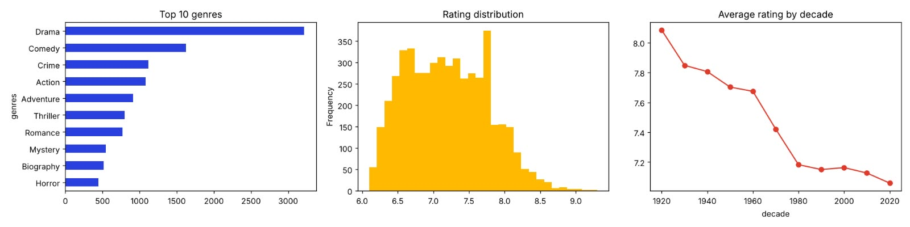

# CineMatch: Movie Recommendations with Machine Learning

CineMatch is a Flask-based movie recommendation project that uses machine learning to find movies similar to a user's interests. Recommendations are generated from movie metadata such as titles, genres, directors, and writers.

The project is designed to evolve from single-title recommendations into personalized recommendations based on a user's **watch history** and **search history**.

## How it works

The recommender uses content-based filtering:

1. Movie metadata is combined into one text feature:

   ```text
   title + genres + directors + writers
   ```

2. `TfidfVectorizer` converts the text features into numerical vectors.
3. Cosine similarity measures how closely movies match one another.
4. The highest-scoring unseen movies are returned as recommendations.
5. If a title is not provided or cannot be found, highly rated movies are shown.

### Personalization from user history

For a personalized version, the same feature pipeline can build a user profile from:

- Movies in the user's watch history
- Movie titles and genres searched by the user
- Ratings, likes, skips, and watch duration
- More recent activity, using time-based weights

The user's watch and search profiles can be combined with movie vectors and ranked with a score such as:

```text
recommendation_score =
    watch_history_similarity
  + search_history_similarity
  + rating_signal
  + recency_signal
  - already_watched_penalty
```

This makes recommendations reflect both what the user has watched and what they are currently searching for, while excluding movies already watched.

## Role of machine learning

Machine learning is used to turn unstructured movie information and user interests into measurable similarities. In this project, `scikit-learn`'s `TfidfVectorizer` learns the importance of words and metadata terms across the movie catalog. Common terms receive less weight, while distinctive terms such as a genre, director, or writer receive more useful weight.

After vectorization, the application uses cosine similarity to compare movies in this feature space. A movie with similar metadata to the user's selected movie, watched movies, or search terms receives a higher similarity score and is ranked nearer the top. This is a content-based recommendation approach: it does not require ratings from other users and can recommend items from the available catalog even when a new user has little activity.

The history-based design uses the same model to create a user preference profile. Watched movies provide long-term preference signals, while search history captures current interests. Recency, ratings, and feedback can be added as weights so that the ranking becomes more personalized over time.

## Features

- Search for a movie title and receive similar recommendations
- TF-IDF and cosine-similarity machine learning pipeline
- Uses title, genre, director, and writer metadata
- Popular fallback recommendations based on ratings
- Cleaned dataset with derived movie metadata
- Responsive Flask web interface
- Dataset analysis visualization

## Project structure

```text
movie-recommendation/
├── app.py
├── requirements.txt
├── README.md
├── assets/
│   ├── movie-analysis.png
│   └── movie-recommender.svg
├── docs/
│   └── CineMatch_ML_Movie_Recommender.pptx
├── data/
│   └── movies_cleaned.csv
├── scripts/
│   ├── analyze_recommendation_correlations.py
│   ├── data_cleaning.py
│   └── train_hybrid_model.py
├── src/
│   ├── __init__.py
│   └── hybrid_recommender.py
├── static/
│   ├── app.js
│   └── styles.css
└── templates/
    └── index.html
```

## Dataset

The cleaned dataset is stored in [`data/movies_cleaned.csv`](data/movies_cleaned.csv). It includes fields such as:

- `title`
- `year`
- `rating`
- `votes`
- `runtime`
- `genres`
- `directors`
- `writers`
- `decade`

The cleaning workflow is available in [`scripts/data_cleaning.py`](scripts/data_cleaning.py). It reads the source Excel workbook configured in the script, normalizes column names and text, handles missing values, removes duplicate title-year pairs, validates ratings, and creates additional features.

## Data cleaning with Python

The dataset is cleaned with the Python libraries **pandas** and **NumPy** before it is used by the recommender:

1. **Load and inspect:** pandas reads the Excel source file and reports its shape, columns, data types, missing values, duplicate rows, and descriptive statistics.
2. **Standardize column names:** whitespace is removed, names are converted to lowercase, and spaces are replaced with underscores. Source names such as `PRIMARY TITLE`, `DIRECTORS`, `WRITERS`, and `GENRES` are mapped to consistent names used by the application.
3. **Normalize text:** title, director, writer, and genre values are converted to strings, trimmed, and cleaned so repeated whitespace and inconsistent comma spacing do not create different-looking values.
4. **Handle missing and invalid values:** missing writers are labeled `Unknown`. Numeric fields such as rating, runtime, votes, and year are converted with `pd.to_numeric`; invalid values become missing and are filled with the relevant median. Rows without a title or genre are removed because they cannot be matched reliably.
5. **Fix data types:** year, runtime, and votes are stored as integers, while ratings are stored as floating-point values.
6. **Remove duplicates:** duplicate title-year pairs are removed while preserving remakes released in different years.
7. **Validate and flag outliers:** ratings are checked to ensure they fall between 0 and 10. NumPy calculates the interquartile range for runtime values, and unusual runtimes are flagged instead of being silently deleted.
8. **Create useful features:** the script derives release decade, main genre, number of genres, movie length category, and a vote-adjusted `weighted_rating`.
9. **Export the cleaned data:** pandas writes the final dataset to `movies_cleaned.csv`; this file is used as `data/movies_cleaned.csv` by the Flask application.

Run the cleaning script after placing the source Excel file in the expected location. The current script expects `movies_cleaned.xlsx` in its working directory and writes `movies_cleaned.csv` there:

```bash
python scripts/data_cleaning.py
```

Move or save the generated CSV as `data/movies_cleaned.csv` for the Flask application. The cleaning step improves recommendation quality by making metadata consistent, preventing missing values from breaking vectorization, and adding structured features that can be used for ranking and analysis.

## Run locally

### Requirements

- Python 3.9 or newer
- pip

### Installation

```bash
git clone https://github.com/kumray/movie-recommendation.git
cd movie-recommendation
python -m venv .venv
```

Activate the virtual environment:

```bash
# macOS/Linux
source .venv/bin/activate

# Windows PowerShell
.venv\Scripts\Activate.ps1
```

Install dependencies:

```bash
pip install -r requirements.txt
```

### Start the application

```bash
python app.py
```

Open [http://localhost:5000](http://localhost:5000) in a browser.

Enter a movie title such as `Inception`, `The Dark Knight`, or `Titanic` to receive recommendations.

## Adding watch and search history

The current web demo accepts one seed movie through the recommendation form. A history-aware implementation can represent activity like this:

```python
watch_history = ["The Matrix", "Inception", "Interstellar"]
search_history = ["science fiction movies", "Christopher Nolan films"]
```

The application can then:

1. Resolve watched titles to rows in the movie dataset.
2. Convert watched movie metadata and search terms into TF-IDF vectors.
3. Build a weighted user preference vector.
4. Compare that vector with every candidate movie.
5. Remove watched titles and return the highest-ranked results.

Search and watch events should be stored securely. Do not commit raw personal history or identifying user data to the repository.

## Exploratory analysis



The analysis shows the most frequent genres, rating distribution, and average rating by decade. These signals can support ranking, filtering, and recommendation explanations.

### Recommendation watch-outcome correlations

To measure which recommendation properties are associated with a movie being watched, run:

```bash
python scripts/analyze_recommendation_correlations.py
```

The script uses the first 80% of each user's ratings as watch history, generates the top 20 recommendations, and labels a recommendation as watched when it appears in that user's later ratings. It calculates Pearson/point-biserial correlations for movie rating, runtime, same-genre match, vote count, popularity, content similarity, and recommendation score. It writes:

- `analysis/recommendation_outcomes.csv` — one row per user/recommendation
- `analysis/recommendation_correlations.csv` — correlation values
- `analysis/recommendation_correlations.png` — correlation bar chart and rating distribution graph

The `watched` column is an observed later-rating proxy for whether a recommendation was watched; it should not be interpreted as a causal effect.

## Evaluation

When watch and search histories are available, evaluate recommendations with:

- Precision@K
- Recall@K
- Mean Average Precision (MAP)
- Normalized Discounted Cumulative Gain (NDCG)
- Diversity and catalog coverage

Use a time-based evaluation split where possible: train on earlier activity and test against movies watched or searched later.

## Privacy and responsible use

Watch and search history can contain sensitive information. Store it securely, minimize retention, anonymize user identifiers, and provide a way to delete a user's history. Recommendations should be treated as suggestions rather than guarantees of user preference.

## Future improvements

- Add watch-history and search-history input to the Flask interface
- Add user profiles and persistent recommendation sessions
- Use recency and feedback weighting
- Add TF-IDF similarity for plot summaries and search text
- Add collaborative filtering when data from multiple users is available
- Add recommendation explanations such as “because you watched...”

## Hybrid machine-learning model

The project now includes [`src/hybrid_recommender.py`](src/hybrid_recommender.py), which combines three signals:

- **Content-based filtering:** TF-IDF vectors and cosine similarity over title, genre, director, and writer metadata.
- **Collaborative filtering:** item-to-item similarity learned from user ratings in a MovieLens-style `ratings.csv` file.
- **Popularity:** a normalized rating-and-vote signal that improves cold-start recommendations.

The final ranking is a weighted hybrid:

```text
score = 0.60 × content_similarity
      + 0.30 × collaborative_similarity
      + 0.10 × popularity
```

Watched titles are excluded from the result list. Search history is added to the content profile, while watched titles contribute to both content and collaborative signals. If no ratings file is available, the collaborative term safely becomes zero and the app continues as a content-plus-popularity recommender.

## Using larger datasets

The model accepts a local MovieLens dataset, a Kaggle export, or an IMDb developer dataset after mapping it to the expected columns. The recommended files are:

```text
data/movies_cleaned.csv
data/ratings.csv
```

`movies_cleaned.csv` should contain `title`, `genres`, and optionally `movieId`, `directors`, `writers`, `rating`, and `votes`. `ratings.csv` should contain:

```text
userId,movieId,rating
1,1,4.0
1,50,5.0
```

MovieLens `movies.csv` and `ratings.csv` can be used directly if the movie metadata is compatible. For Kaggle or IMDb data, clean and map identifiers first; do not merge on title alone when a stable movie ID is available. Large source archives should not be committed to Git. Keep them locally or in object storage and commit only the processed sample, schema, and reproducible scripts.

Train and save the hybrid model with:

```bash
python scripts/train_hybrid_model.py \
  --movies data/movies_cleaned.csv \
  --ratings data/ratings.csv \
  --output data/hybrid_model.joblib
```

The Flask app automatically loads `data/ratings.csv` when it exists. The training script is useful for validating a large ratings export and creating a reusable model artifact; retrain it when the catalog or ratings data changes.

The project presentation is available at [`docs/CineMatch_ML_Movie_Recommender.pptx`](docs/CineMatch_ML_Movie_Recommender.pptx).

## Accuracy and evaluation

More data does not automatically mean better recommendations. Measure improvements on a time-based holdout set so future interactions are not used to predict the past. Track Precision@K, Recall@K, NDCG@K, coverage, and diversity, and compare content-only against the hybrid weights before deploying a change.
